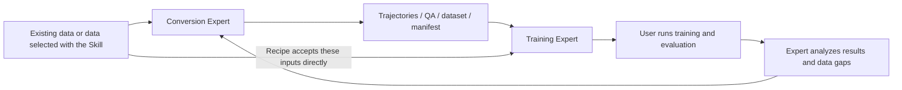

# OpenAoE Expert Best Practices: From Demonstrations to Data and Model Experiments

[简体中文](aiwork-expert-best-practices.zh-CN.md) | English · [Skill guide](aiwork-skill-best-practices.md)

**Give the Expert your data, robot, and goal. Complete one short example before expanding conversion or training.**

Applies to Human-to-Robot Data Conversion Expert `0.3.2` and Embodied Model Training Expert `0.2.2`. Workflows, capability diagrams, and output examples show how to prepare robot data and model experiments.

## 1. What the two Experts can do

| Expert | Goals you can bring | Main deliverables |
| --- | --- | --- |
| **Human-to-Robot Data Conversion Expert** | Assess conversion feasibility, adapt motion to a robot, and inspect failures | Trajectories, replay, optional robotized video, QA reports, a dataset and manifest |
| **Embodied Model Training Expert** | Assess trainability, compare recipes, prepare a small run, and diagnose failures | Schema checks, recipe suggestions, preflight/training/evaluation commands, result analysis, and data requests |

Each product has one Expert and five internal Skills. The independent data-selection Skill has its [own guide](aiwork-skill-best-practices.md). Start there if you need to find data; continue here if your inputs are already available.

### Conversion: from what a person did to how a robot can move


*The conversion Expert connects human demonstrations, reconstruction and retargeting methods, and robot-specific action and dataset outputs.*

Example requests:

- “I have ordinary RGB video and a robot URDF. Assess what can be recovered.”
- “Convert existing MANO and camera trajectories to G1 + Dex3; inspect 30 seconds first.”
- “Find the worst joint-limit violations or abrupt motion and produce replay and QA.”
- “List missing assets, action definitions, and validation steps for a new robot.”

### Training: from readable data to an experiment you can evaluate


*The training Expert covers action prediction with VLA, action-conditioned future imagery with WAM, and environment dynamics or representations with world and latent-action models.*

Example requests:

- “Check whether this LeRobot dataset can train SmolVLA and propose a minimal test.”
- “Compare pretraining and fine-tuning routes for Ego data plus a small robot dataset.”
- “Compare ACT, Diffusion Policy, and a VLA candidate using the same data and budget.”
- “Loss looks healthy but task success is poor. Inspect data, action definitions, and the model.”

**The training Expert generates commands; you execute them on your compute and return logs for analysis.** The Expert uses checkpoints and evaluation results to recommend the next improvements.



## 2. What to prepare

### Add Experts from the community

1. Open **Experts · Skills (专家·技能)** in AiWork's sidebar, select **Experts (专家)**, and enter the **Expert Community (专家社区)**.
2. In the **Experts (专家)** tab, search separately for **`人类数据转换专家`** (Human-to-Robot Data Conversion Expert) and **`具身模型训练专家`** (Embodied Model Training Expert). Use these exact Chinese search terms, then select and add each Expert.
3. Return to your project task, select an Expert in the conversation, and provide your data location and goal.


### Upload the packages manually

You can also download the two ZIP files below. In the Expert Community, click **Add Expert (添加专家)** and use the upload option to import each package separately. Use this route if the Experts do not appear in search.

| Expert | Package and repository path |
| --- | --- |
| Human-to-Robot Data Conversion Expert `0.3.2` | [packages/aiwork/human-data-conversion-expert-0.3.2-upload-v4.zip](../packages/aiwork/human-data-conversion-expert-0.3.2-upload-v4.zip) |
| Embodied Model Training Expert `0.2.2` | [packages/aiwork/embodied-training-expert-0.2.2-upload-v4.zip](../packages/aiwork/embodied-training-expert-0.2.2-upload-v4.zip) |

See the [package directory](../packages/aiwork/README.md) for download instructions and checksums. Select each installed Expert and verify its version.

Keep data and outputs in the same project workspace. When switching Experts, provide the execution host, file paths, and a handoff note. The ZIP files provide Expert definitions and supporting Skills. After importing them, prepare the Open-AoE code, dependencies, model weights, and robot assets to start your experiment.

### Provide four things up front

| Information | Example |
| --- | --- |
| Task | “Check whether kitchen pick-and-place demonstrations are suitable for an initial model experiment.” |
| Data location and type | “An OpenAoE download directory containing video, hand reconstruction, camera trajectories, and action annotations.” |
| Target robot or modeling goal | “G1 + Dex3 simulation replay,” or “future video prediction only.” |
| Compute and budget | “Linux, NVIDIA GPU model and memory, available disk space; a small experiment only.” |

The current Expert versions require **Linux with an NVIDIA GPU** for execution. If you interact from macOS or Windows, prepare an accessible Linux GPU host; preferably provide an existing SSH connection alias. Check the environment first, then prepare a pinned Open-AoE checkout and the target robot and end-effector URDF/MJCF files, including referenced meshes.

For the standalone Skill, use a Python environment for metadata queries, filtering, and ordinary charts. Prepare rendering dependencies and model assets for MANO review videos. See the [visualization guide](../aoe-visualization) and [reconstruction and retargeting guide](../aoe-reconstruct-retarget/README.md).

## 3. Recommended workflow: short conversion → handoff → small training run → evaluation

Prepare 1–3 complete, inspected samples. If you need data, follow the [Skill guide](aiwork-skill-best-practices.md) for selection, downloading, and review. The workflow below starts with existing inputs.

### Step 1: Convert one short window

Switch to the Human-to-Robot Data Conversion Expert and provide the previous outputs:

```text
Execution host: <Linux GPU host alias>
Sample directory: <absolute path on that host>
Quality report: <report path>
Target: G1 + Dex3, initially for simulation replay and training-data feasibility.

Check the environment, code version, and robot and hand assets first.
Select about 30 continuous valid seconds from one approved sample, recording
the original frame and time ranges. Reuse the existing MANO reconstruction
and camera trajectories after checking them.
First produce trajectories, a replay video, failed-frame records, and QA.
Optionally generate robotized video for visual review.
Package the data after QA, and document action semantics, robot profile,
timing, provenance, and the supported uses in manifest.json.
```

**Start with G1 + Dex3.** The Expert package provides a profile and an end-to-end example. For another robot, use the corresponding Open-AoE subproject to prepare assets, adapters, and a validation example.

**Retargeting** translates human motion into robot motion using the robot's arm lengths, joints, and hand structure. Record and exclude intervals with serious limit violations, solver failures, or abrupt jumps, or explicitly restrict the result to visualization.

**Keep:** Trajectories, replay video, QA report, dataset, and `manifest.json`. The report summarizes limits, smoothness, collisions, contact, and task completion to help select useful intervals.

### What conversion outputs look like


*G1 + Dex3 six-panel example. Read left to right, top to bottom: input, external robot view, keypoints, segmentation, background repair, and composition. Intermediate panels help inspect each stage.*


*The first-person composite shows the robot in the original scene, helping you inspect motion, perspective, and object positions.*


*G1 + Inspire QA example over 400 frames: joint trajectories, IK errors, and joint-limit utilization.*

Look for jumps, failure intervals, error units, and joint-limit use. The robot, input window, and backend should match the manifest.

### Step 2: Hand over the data with a clear description

Think of `manifest.json` as the dataset's instruction manual: it explains what each number means and how it relates to the video.

| What to document | Why it matters |
| --- | --- |
| `observation_schema`: cameras, modalities, resolution, frame rate | Defines what the model sees |
| `state_schema` / `action_schema`: dimensions, ordered fields, units, coordinates | Prevents mixing numbers with different meanings |
| Absolute versus delta actions, and state/action time offsets | Distinguishes “where to go” from “how far to move” and defines the prediction target |
| Control/video frequencies, synchronization, and crop ranges | Keeps observations and actions aligned |
| Robot profile, task, invalid-frame handling, and QA results | Identifies appropriate uses and intervals to exclude |
| Sources, input checksums, code/configuration versions, and license information | Preserves traceability |

The Skill's `_openaoe_manifest.json` describes **download provenance and file checksums**. The conversion Expert's `manifest.json` describes **converted data semantics**. Preserve both and link their provenance.

**Record the action layout for each profile.** G1 + Dex3 uses 28D as `[left arm 7, right arm 7, left hand 7, right hand 7]`; another existing layout uses `[left arm 7, right arm 7, left hand 6, right hand 6, padding 2]`. Document the ordered fields and meanings in the manifest before adapting the data to a model.

The public LeRobot recipe provides a 110D human-hand current/next-state representation. The conversion Expert defaults to LeRobot v2.1; align action semantics with the target recipe when connecting it to a model. See the [LeRobot data definition](../aoe-training-ready/lerobot/README_OPEN_AOE.md).

### Step 3: Request a small training plan

```text
Execution host and GPU: <host alias, model, memory>
Dataset root: <absolute path>
Download provenance: <path to _openaoe_manifest.json>
Converted data description: <path to manifest.json>
QA and replay: <paths>
Goal: verify that this data can enter a real model's training workflow.

Compare the dataset schema field by field with the current repository recipes.
Suggest 2–3 candidates backed by actual code, first considering a small ACT
baseline. List the adapter steps needed for this robot action layout.
After confirming environment readiness and compatibility, provide preflight
and small-batch smoke commands for about 20 steps. Include code and data
versions, configuration hash, seed, dependencies, weights, and output paths.
I will run training and evaluation. Review my returned logs before deciding
whether to move to a full training run.
```

A **smoke test** uses a small amount of data and a few training steps to check real data loading, forward computation, backpropagation, parameter updates, and logging. About 20 steps is a starting point. Five to ten minutes is a target after setup; actual time depends on the model, GPU, and decoding, and excludes initial installation and downloads.

Smoke acceptance checks: successful data loading, stable numbers, parameter updates, and readable logs and curves. Set a checkpoint interval suitable for the short run and verify that the model reloads. Use independent evaluation to measure task performance.

### What a training run should return


*ACT-lite, 100-step training example: loss on the left, learning rate in the middle, and gradient norm on the right.*

Save the actual configuration, complete logs, a loadable checkpoint, and independent evaluation results for analysis and reproducibility.

### Step 4: Return the results and decide whether to scale up

```text
Here are the smoke configuration, complete logs, loss curve, and checkpoint:
<paths>.
Separate “the training workflow runs” from “the model performs the task.”
If the workflow passes, provide the next training and independent evaluation
plan. Otherwise, diagnose the failure and propose a minimal change.
Use an evaluation environment matching the robot and action space.
Specify success criteria, trial counts, and how to save failed examples.
If a compatible environment is missing, identify what needs to be added.
```

After the small run passes, expand to multiple independent clips and create training and validation/test splits. Where possible, keep neighboring clips from the same recording in one split to avoid nearly identical scenes appearing in both training and testing.

Match evaluation to the goal: use per-dimension errors and closed-loop behavior for action prediction, and frame quality and action-conditioning behavior for video prediction. Match the simulation environment to the robot observation and action spaces. Start with offline evaluation, then test closed-loop tasks.

## 4. Adapt the route to your starting point

| What you have | Suggested route |
| --- | --- |
| Public OpenAoE data, no robot | Filter and review first; choose human-representation training or robot conversion and simulation based on your goal |
| LeRobot data from your target robot | Ask the training Expert to check the schema, then run a small training test if compatible |
| Human data and a little real-robot data | Check action semantics and camera differences before designing pretraining/fine-tuning or an explicit cross-embodiment approach |
| Ordinary RGB video without calibration | Ask the conversion Expert what can be recovered; restrict the intended use when scale or visibility is insufficient |
| A goal of predicting video under actions | Check action-conditioned video recipes and synchronized action labels; without action labels, inspect latent-action/world-model recipes separately |
| A new robot | Add its profile, assets, joint order, control frequency, and validation example before batch processing |

Choose candidates from the [public recipe index](../aoe-training-ready/README.md), considering the task, data semantics, dependencies, and budget. Use preflight measurements to finalize the configuration.

## 5. What to ask when something fails

| Symptom | Useful follow-up |
| --- | --- |
| No matching samples | “Show match counts for each condition, suggest which one to relax, and preserve the original filters.” |
| Missing MANO, URDF, or mesh files | “List the missing files, their sources, and the stages that depend on them.” |
| Reversed hands or abrupt joint motion | “Check handedness, coordinate transforms, joint order, and signs; show the affected frames.” |
| The robot misses objects or intersects geometry | “Check trajectories, camera alignment, and contact; separate geometry errors from compositing errors.” |
| Data loads, but training reports dimension errors | “Compare the manifest with model inputs field by field, including physical meaning.” |
| GPU memory runs out | “Suggest a smaller batch, resolution adjustment, or smaller model; record the changes and rerun smoke.” |
| Healthy loss, poor task behavior | “Check absolute/delta actions, normalization, control frequency, temporal offsets, and camera views.” |
| Successful logs but no saved model | “Check save intervals and output paths, and verify checkpoint loading.” |

## 6. Keep the experiment easy to continue

1. **Start small.** Review three samples and one short conversion before expanding downloads or training.
2. **Preserve evidence.** Keep filters, seeds, code/data versions, configuration hashes, QA reports, and logs.
3. **Evaluate each intended use.** Give separate conclusions for review videos, replayable trajectories, recipe-compatible data, and task-performing models.
4. **Turn failures into the next data request.** Ask the training Expert which tasks, objects, or conditions fail most, then use the Skill to select data or the conversion Expert to process it.

For example: “Add low-light cup-placement samples using the same robot profile and action schema, preserve data-version records, and inspect three examples first.” This is easier to execute and compare than “add more data.”

For robotized video experiments, inspect temporal and visual consistency and compare training results with and without the generated imagery. See [LEGAL](../LEGAL.md) for component licenses and attribution.

## 7. Further reading

- [Open-AoE repository](https://github.com/ant-research/Open-AoE)
- [OpenAoE-2000h on ModelScope](https://www.modelscope.cn/datasets/inclusionAI/OpenAoE-2000h) · [Hugging Face](https://huggingface.co/datasets/inclusionAI/OpenAoE-2000h)
- [Data specification](../open-aoe-2000h)
- [Visualization](../aoe-visualization)
- [Reconstruction and retargeting](../aoe-reconstruct-retarget)
- [Training recipes](../aoe-training-ready)

See the [asset index](assets/aiwork/SOURCES.md) for the illustrations.

**For your first session, copy the first prompt in Section 3. Review one conversion before validating a model experiment.**
