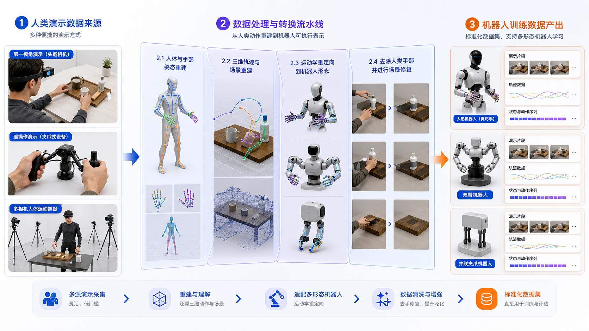
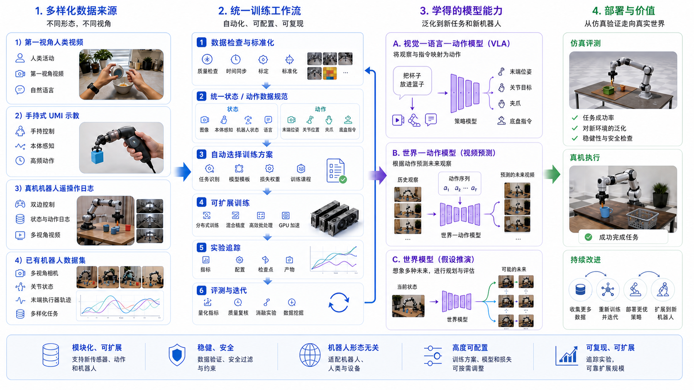
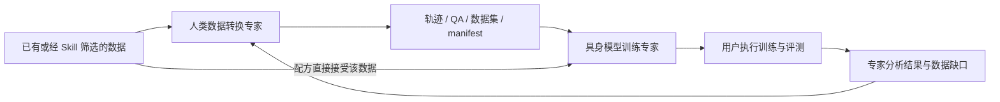
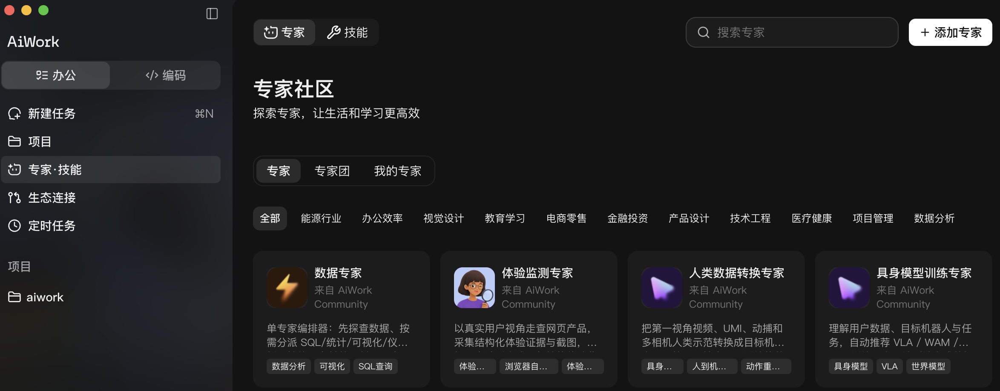
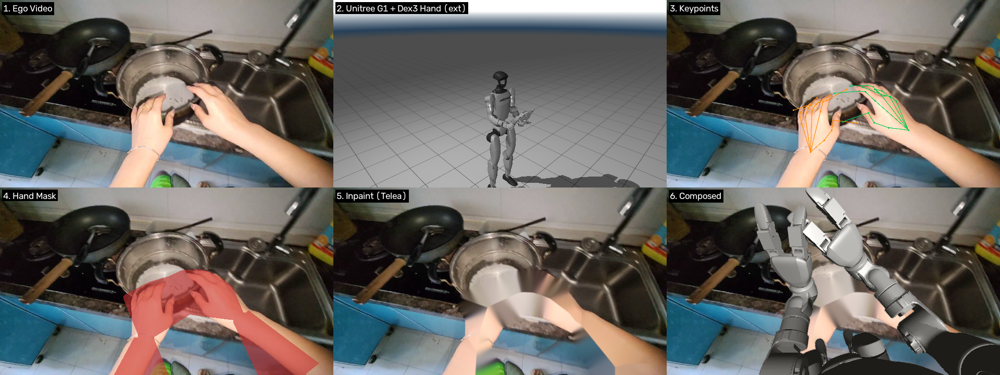
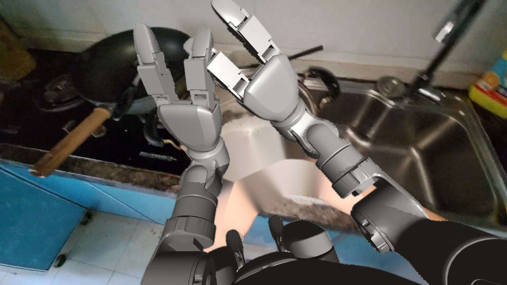
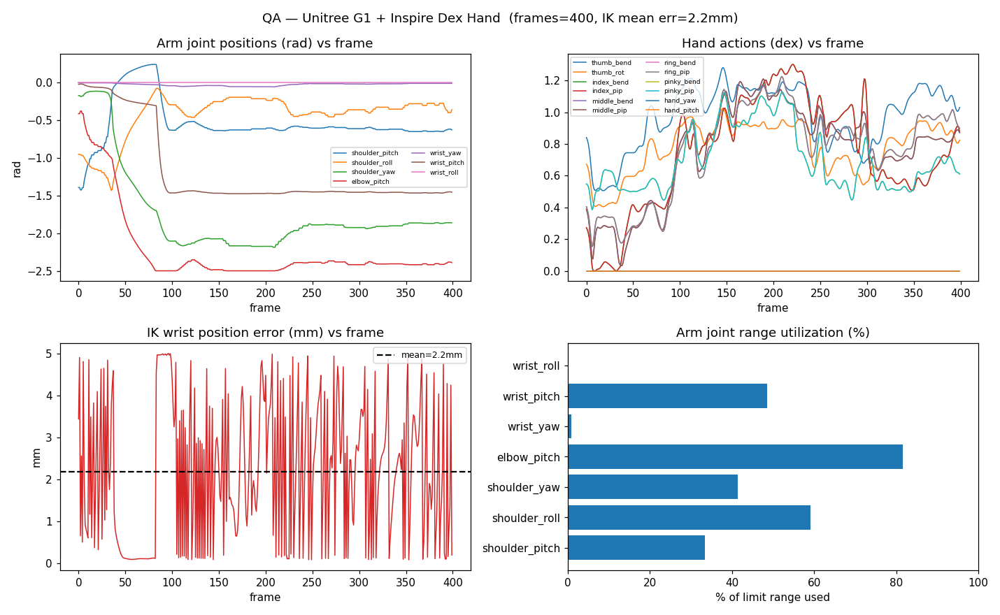
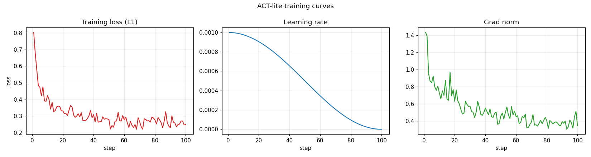

# OpenAoE Expert 最佳实践：把示范转换成数据，把数据变成模型实验

简体中文 | [English](aiwork-expert-best-practices.md) · [Skill 最佳实践](aiwork-skill-best-practices.zh-CN.md)

**告诉专家你的数据、机器人和目标，先完成一个短样例，再决定怎样扩大转换与训练。**

适用版本：人类数据转换专家 `0.3.2`、具身模型训练专家 `0.2.2`。下面通过工作流、能力图和交付示例，介绍如何完成数据转换与模型实验。

## 1. 两个专家分别能做什么

| 专家 | 你可以交给它的目标 | 主要交付物 |
| --- | --- | --- |
| **人类数据转换专家** | 判断人类数据能转到什么程度；把动作适配到目标机器人；检查异常帧 | 动作轨迹、回放、可选机器人化视频、QA 报告、数据集与 manifest |
| **具身模型训练专家** | 判断数据能训练什么；比较配方；准备最小训练；分析失败 | 数据对账、配方建议、预检/训练/评测命令、结果分析和补数据建议 |

每个产品都是单一专家，内部包含 5 个 Skill。独立的数据检索 Skill 则有[自己的最佳实践](aiwork-skill-best-practices.zh-CN.md)。需要先找数据时，从那里开始；已有数据时直接进入本指南。

### 人类数据转换：从“人做过”到“机器人如何动”



*人类数据转换专家：连接多种人类示范、重建与重映射方法，输出目标机器人的动作和训练数据。*

可以这样提出需求：

- “我只有普通 RGB 视频和机器人 URDF，先判断能恢复哪些信息。”
- “已有 MANO 和相机轨迹，转换到 G1 + Dex3，先检查 30 秒。”
- “找出关节越界或动作跳变最严重的片段，生成回放与质量报告。”
- “为新机器人列出缺少的资产、动作定义和验证步骤。”

### 具身模型训练：从“数据能读取”到“实验能评测”



*具身模型训练专家：VLA 侧重动作预测，WAM 侧重动作条件下的未来画面，WM/潜在动作侧重环境变化与表示学习。*

可以这样提出需求：

- “检查这批 LeRobot 数据能否训练 SmolVLA，先给最小验证方案。”
- “我有 Ego 数据和少量真机数据，比较可行的预训练与微调路线。”
- “在相同数据和预算下比较 ACT、Diffusion Policy 与一个 VLA 候选。”
- “loss 正常但任务成功率低，帮我定位数据、动作定义或模型的问题。”

**训练专家生成命令，你在自己的算力上执行，并回传日志供分析。** 专家结合模型文件与评测结果，给出下一轮改进建议。



## 2. 开始前准备什么

### 从专家社区添加

1. 在 AiWork 左侧进入 **专家·技能**，切换到 **专家**，打开 **专家社区**。
2. 在 **专家** 标签中分别搜索 **`人类数据转换专家`** 和 **`具身模型训练专家`**，选择对应专家并添加。
3. 回到项目任务，在对话中选择需要的专家，提供数据位置和任务目标。



### 手动上传安装包

也可以下载仓库中的两个 ZIP，在专家社区点击 **添加专家**，通过上传入口分别导入。搜索不到专家时，使用这一方式即可。

| 专家 | 安装包与仓库路径 |
| --- | --- |
| 人类数据转换专家 `0.3.2` | [packages/aiwork/human-data-conversion-expert-0.3.2-upload-v4.zip](../packages/aiwork/human-data-conversion-expert-0.3.2-upload-v4.zip) |
| 具身模型训练专家 `0.2.2` | [packages/aiwork/embodied-training-expert-0.2.2-upload-v4.zip](../packages/aiwork/embodied-training-expert-0.2.2-upload-v4.zip) |

下载方式和校验值见[安装包目录](../packages/aiwork/README.md)。安装后选择对应专家，确认版本。

在同一个项目工作区保存数据与产物。切换专家时，提供执行主机、文件路径和交接说明。这两个 ZIP 提供专家定义与配套 Skill；导入后，准备 Open-AoE 代码、依赖、模型权重和机器人资产，即可开始实验。

### 一次说清四件事

| 要提供的信息 | 示例 |
| --- | --- |
| 想完成的任务 | “先验证厨房中的拿放动作能否用于模型实验” |
| 数据位置与形态 | “OpenAoE 下载目录；含视频、手部重建、相机轨迹、动作标注” |
| 目标机器人或模型目标 | “G1 + Dex3 仿真回放”，或“只研究未来视频预测” |
| 执行环境与预算 | “Linux、NVIDIA GPU 型号/显存、可用磁盘；本轮只做小样例” |

当前两个专家版本以 **Linux + NVIDIA GPU** 为执行环境要求。使用 macOS 或 Windows 作为交互电脑时，准备可访问的 Linux GPU 执行主机；优先提供已有 SSH 连接别名。先核对环境，再准备固定版本的 Open-AoE 代码和目标机器人本体、灵巧手或夹爪的 URDF/MJCF 及网格资产。

独立 Skill 的元数据检索、筛选与一般图表操作使用 Python 环境；MANO 审阅视频需准备渲染依赖和模型资产。依赖与资产获取参见[可视化说明](../aoe-visualization)和[重建与重映射说明](../aoe-reconstruct-retarget/README.md)。

## 3. 推荐实践：短样例转换 → 数据交接 → 最小训练 → 评测

先准备 1–3 个完整且检查过的样本。还没有数据时，按 [Skill 指南](aiwork-skill-best-practices.zh-CN.md)完成检索、下载和审阅；下面从已有输入开始。

### 第一步：让转换专家先处理一个短窗口

切换到“人类数据转换专家”，提供前一步的文件：

```text
执行主机：<Linux GPU 主机别名>
样本目录：<执行主机上的绝对路径>
质检报告：<报告路径>
目标：G1 + Dex3，先做仿真回放与训练数据可行性验证。

先检查环境、代码版本、机器人和手部资产，再从一个合格样本中
选择约 30 秒的连续有效窗口，记录原始帧范围和时间范围。
已有 MANO 与相机轨迹通过检查后直接复用。
请先输出动作轨迹、回放视频、失败帧列表和 QA 报告；
可选生成机器人化视频，用于视觉复核。
通过 QA 后再打包，并在 manifest.json 中写清动作含义、
机器人 profile、时序、数据来源和实际允许的用途。
```

**推荐从 G1 + Dex3 开始。** 专家包提供对应 profile 和端到端样例。适配其他机器人时，可从 Open-AoE 对应子项目准备资产、适配器和验证样例。

这里的 **Retarget（动作重映射）**，就是根据机器人的臂长、关节和手型，把人类动作转成该机器人的动作。遇到严重越界、求解失败或跳变，应记录并排除相应区间，或明确降级为仅供可视化的结果。

**拿到什么：** 动作文件、回放视频、QA 报告、数据集和 `manifest.json`。报告汇总限位、平滑性、碰撞、接触与任务完成情况，帮助你选择可用片段。

### 转换完成后，你会看到这些产物



*G1 + Dex3 六联转换示例：从左到右、从上到下依次为输入、外景机器人、关键点、分割、背景修复和合成，便于定位各阶段的效果。*



*第一视角合成画面：直观呈现目标机器人与原场景的空间关系，便于检查动作、视角与物体位置。*



*G1 + Inspire、400 帧 QA 示例：展示关节轨迹、IK 误差与限位利用率。*

阅读 QA 时先看曲线是否有跳变，再看失败帧、误差单位和关节限位。机器人型号、输入窗口和后端必须与 manifest 一致。

### 第二步：用一份清单把数据交给训练专家

`manifest.json` 可以理解为数据的“说明书”：告诉下一个专家每个数字代表什么，以及这些数字怎样与视频对应。

| 必须讲清楚 | 为什么需要 |
| --- | --- |
| `observation_schema`：相机、模态、分辨率、帧率 | 决定模型看到什么 |
| `state_schema` / `action_schema`：维度、逐项顺序、单位、坐标系 | 防止把不同含义的数字当成同一动作 |
| 动作是绝对位置还是增量，以及 state/action 时间偏移 | 区分“到哪里”和“移动多少”，明确预测目标 |
| 控制频率、视频频率、同步和裁剪范围 | 保证画面与动作处于正确时刻 |
| 机器人 profile、任务描述、无效帧处理、QA 结果 | 判断数据能用于哪个任务，哪些区间应排除 |
| 数据来源、输入校验值、代码与配置版本、许可信息 | 保留可追溯记录 |

Skill 的 `_openaoe_manifest.json` 记录**下载来源和文件校验**；转换专家的 `manifest.json` 记录**转换后的数据语义**。两份都保留，并建立来源关联。

**按 profile 记录动作布局。** G1 + Dex3 的 28D 为 `[左臂7，右臂7，左手7，右手7]`；另一种既有 28D 为 `[左臂7，右臂7，左手6，右手6，填充2]`。在 manifest 中写明逐项顺序和含义，再进行模型适配。

公开 LeRobot 配方提供 110D 人手当前状态/下一帧状态表示。转换专家默认输出 LeRobot v2.1，接入模型时按目标配方对齐动作语义。[LeRobot 配方的数据定义](../aoe-training-ready/lerobot/README_OPEN_AOE.md)

### 第三步：请训练专家给出最小训练方案

```text
执行主机与 GPU：<主机别名、型号、显存>
数据根目录：<绝对路径>
下载血缘：<_openaoe_manifest.json 路径>
转换说明：<manifest.json 路径>
QA 与回放：<文件路径>
目标：先确认这批数据能够进入一个真实模型的训练流程。

请逐项核对数据 schema 与当前仓库配方，给出 2–3 个有代码依据的候选，
优先评估 ACT 小基线，列出对齐这个机器人动作布局需要的适配步骤。
环境和数据兼容性确认后，给出预检脚本和约 20 步的小 batch smoke 命令，
写清代码版本、数据版本、配置哈希、seed、依赖、权重与输出路径。
训练与评测由我执行；我回传日志后再判断能否开始正式训练。
```

**Smoke test（最小训练验证）** 是用很少的数据和训练步数，检查真实数据读取、前向计算、反向传播、参数更新与日志保存是否能走通。约 20 步只是起点；5–10 分钟是环境就绪后的目标时间，实际受模型、GPU 和数据解码影响，不包含首次安装与下载。

最小训练验收：数据正常读取、数值稳定、参数更新、日志和曲线可读。设置适合短训练的 checkpoint 保存间隔，并检查模型能否重新加载；随后通过独立评测衡量任务效果。

### 训练运行后，你会拿到什么



*ACT-lite、100 步训练示例：左为 loss，中为学习率，右为梯度范数，帮助你观察训练过程。*

除了曲线，保存实际配置、完整日志、可加载 checkpoint 及独立评测结果，供专家分析与后续复现。

### 第四步：回传结果，决定是否扩大

```text
这是 smoke 的配置、完整日志、loss 曲线和 checkpoint 路径：<路径>。
请区分“训练流程跑通”和“模型任务有效”两个结论。
若流程通过，给出下一轮训练与独立评测计划；
若未通过，定位原因并给出最小修改。
评测请使用匹配机器人与动作空间的环境，写明成功标准、
测试次数和失败样例保存方式；无对应环境时明确缺少什么。
```

小样例通过后，再扩大为多个独立片段，划分训练集与验证/测试集。同一次采集中的相邻片段尽量放在同一划分，避免模型在测试时看到与训练近乎重复的画面。

按目标选择评测：动作预测查看分维度误差和闭环表现，视频预测查看画面质量与动作条件的作用。仿真环境应匹配机器人的观察和动作空间；先完成离线评测，再开展闭环任务测试。

## 4. 根据起点调整路线

| 你现在有什么 | 建议怎么走 |
| --- | --- |
| 只有公开 OpenAoE 数据，没有真机 | 先筛选与审阅；按目标选择人手表示训练或机器人转换与仿真路线 |
| 已有目标机器人的 LeRobot 数据 | 直接找训练专家做 schema 检查，兼容时进入最小训练 |
| 人类数据 + 少量真机数据 | 先核对动作语义和相机差异，再设计预训练/微调或显式跨本体方案 |
| 只有普通 RGB 视频，没有标定 | 先找转换专家评估可恢复的信息；尺度、遮挡等不足时降低输出用途 |
| 想预测动作之后的未来视频 | 选择动作条件视频路线，核对动作标签与时序；无动作标签时另查潜在动作/世界模型配方 |
| 想适配新机器人 | 先补 robot profile、资产、关节顺序、控制频率和验证样例，再做批处理 |

从[公开配方索引](../aoe-training-ready/README.md)选择候选，结合任务、数据语义、依赖和预算，用实际预检确定配置。

## 5. 常见问题：卡住时怎样问

| 现象 | 下一步可以这样问 |
| --- | --- |
| 搜不到符合条件的样本 | “列出各条件的命中数，建议先放宽哪一项，并保留原始筛选记录。” |
| 缺 MANO、URDF 或 mesh | “列出缺失文件、获取来源和依赖该资产的步骤。” |
| 左右手反了、关节有跳变 | “检查手别、坐标变换、关节顺序与符号约定，给出异常帧对比。” |
| 视频里的机器人抓空或穿模 | “先核对轨迹、相机和接触关系，区分几何问题与图像合成问题。” |
| 数据能读取但训练维度报错 | “逐字段比较 manifest 与模型输入配置，说明不兼容的物理含义。” |
| 显存不足 | “给出减小 batch、调整分辨率或切换小模型的选项，记录改动后重跑 smoke。” |
| loss 正常，但任务失败 | “核对 action 的绝对/增量、归一化、控制频率、时序偏移与观察视角。” |
| 日志显示成功，却没有模型文件 | “检查保存间隔和输出路径，验证 checkpoint 能否加载。” |

## 6. 做到这几点，实验才方便继续

1. **先小后大。** 先验收 3 个样本和 1 段短转换，再扩大下载与训练规模。
2. **保存每一步的依据。** 留下筛选条件、种子、代码版本、数据版本、配置哈希、QA 和日志。
3. **按用途验收。** 审阅视频、可回放轨迹、可用于某配方的数据和能完成任务的模型，分别给出结论。
4. **把失败变成下一轮输入。** 让训练专家列出失败最集中的任务、物体或条件，再交给 Skill 筛选或转换专家处理。

例如：“补充低光照下拿放杯子的样本，沿用当前 robot profile、动作 schema 和数据版本记录；先检查 3 个样例。”比“再多加些数据”更容易执行和比较。

开展机器人化视频实验时，检查时序与视觉一致性，并对比加入合成图像前后的训练效果。组件许可与署名说明见项目 [LEGAL](../LEGAL.md)。

## 7. 继续阅读

- [Open-AoE 项目主页](https://github.com/ant-research/Open-AoE)
- [OpenAoE-2000h：ModelScope](https://www.modelscope.cn/datasets/inclusionAI/OpenAoE-2000h) · [Hugging Face](https://huggingface.co/datasets/inclusionAI/OpenAoE-2000h)
- [数据规范](../open-aoe-2000h)
- [可视化工具](../aoe-visualization)
- [重建与重映射](../aoe-reconstruct-retarget)
- [模型训练配方](../aoe-training-ready)

配图索引见[素材说明](assets/aiwork/SOURCES.md)。

**第一次使用，从第三节的第一条对话开始。先验收一段转换结果，再验证一个模型实验。**
