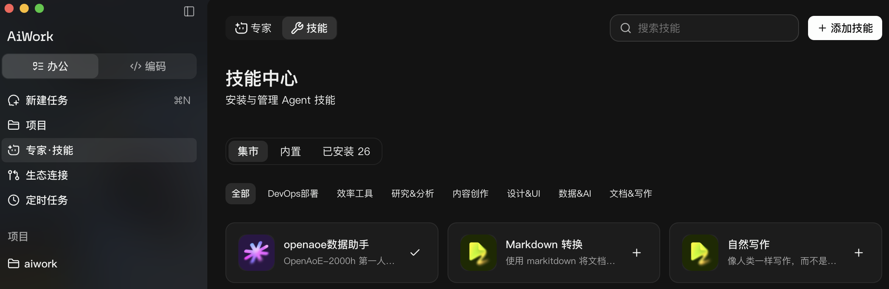
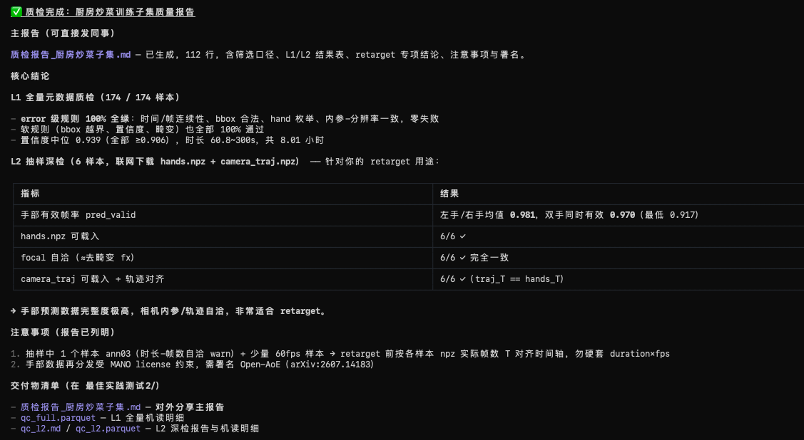
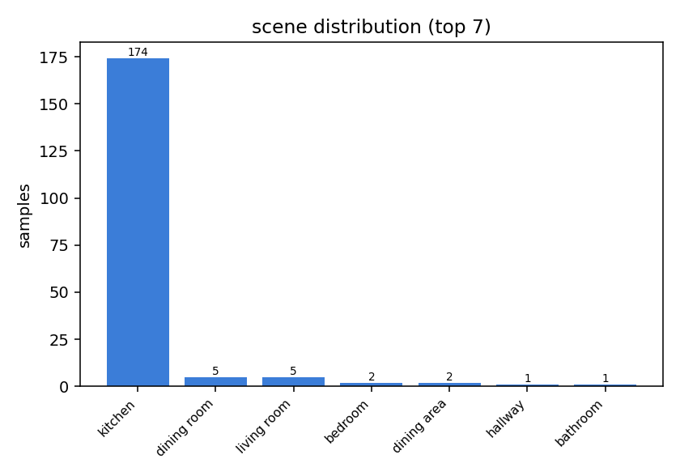
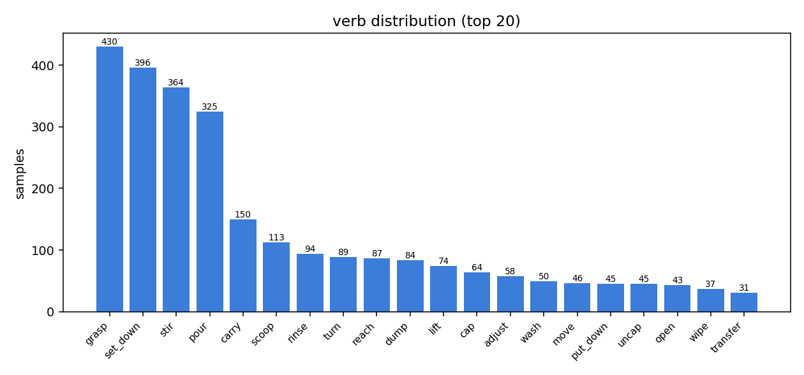
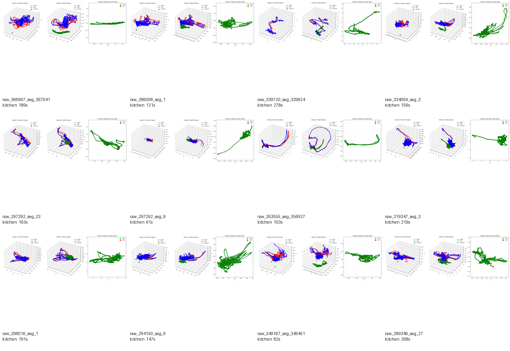
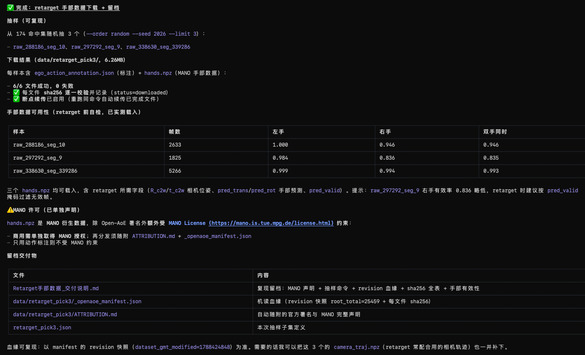
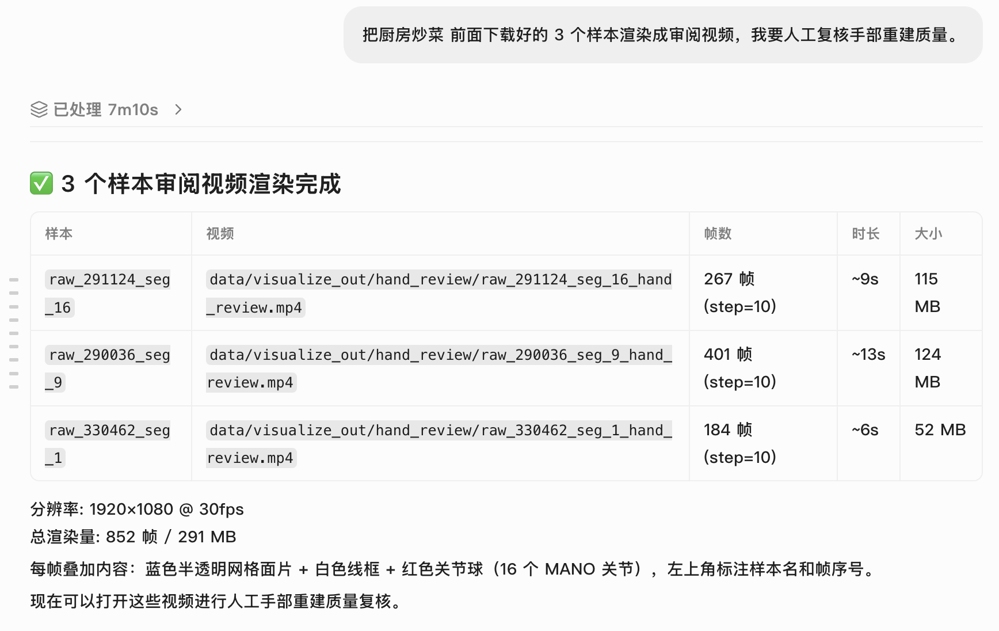

# OpenAoE Skill Best Practices: Find, Inspect, and Download Data Through Conversation

[简体中文](aiwork-skill-best-practices.zh-CN.md) | English · [Expert guide](aiwork-expert-best-practices.md)

**Start with “I need kitchen cooking demonstrations” and finish with inspectable sample lists, quality reports, charts, and review videos.**

This guide focuses on the `openaoe-data-ops` Skill: dataset queries, filtering, quality checks, visualization, and downloads. Robot conversion and model training preparation are covered in the separate Expert guide.

## 1. How to use it in AiWork

### Install from the Skill Center

1. Open **Experts · Skills (专家·技能)** in AiWork's sidebar, select **Skills (技能)**, and enter the **Skill Center (技能中心)**.
2. In **Marketplace (集市)**, search for **`openaoe数据助手`**, select the matching Skill, and install it. Use this exact Chinese search term.
3. Choose a project directory for data and outputs, then describe your task. The package name is `openaoe-data-ops`.



### Upload the package manually

You can also download [openaoe-data-ops.zip](../packages/aiwork/openaoe-data-ops.zip) from this repository. In the Skill Center, click **Add Skill (添加技能)** and use the upload option to select the ZIP and complete installation. Use this route if the Skill does not appear in search.

Repository path: `packages/aiwork/openaoe-data-ops.zip`. See the [package directory](../packages/aiwork/README.md) for download instructions and checksums. Keep the bundled seed index and its companion state file, and check for index updates on first use.

Provide the **purpose, filters, download scope, and output directory**. The Skill translates these into data operations and returns files. Start with a task description, then review how the Skill maps it to data filters.

Run metadata queries, filtering, and charts in a Python environment. For hand-mesh review, prepare MANO and rendering dependencies, then render a short window before processing longer clips. Continue to the Expert guide for robot conversion and model training.

## 2. Worked example: select a kitchen cooking subset

Follow a kitchen cooking subset through six steps: exploration, filtering, quality checks, visualization, downloading, and review. Figures show the deliverables from each stage.

### Step 1: Find out what is available

```text
How many samples are in the current OpenAoE index, and what is its version?
Summarize scenes, actions, durations, resolutions, and devices.
Update an outdated index first. Start with metadata only.
```

**Outputs:** Dataset overview, distributions, and index version. Reuse a seed index and update it incrementally; save its version alongside the statistics.

### Step 2: Turn “mostly cooking” into explicit filters

```text
Find kitchen samples lasting 1–5 minutes, with bimanual actions, 1080p video,
average annotation confidence of at least 0.9, and predominantly stir-frying.
Explain the verb, object, action-duration share, or ranking rules used for
“predominantly stir-frying.” Show match counts and object distributions
after each refinement. Save the full candidate set, then randomly select
3 samples with seed=2026 for review.
```

**Outputs:** Explicit filters, the full candidate set, and sampled IDs. `stir` can cover stirring soup or mixing salad; refine the selection with cookware objects and action-duration criteria. Apply random sampling and limits at the end.

### Step 3: Check quality at two levels

```text
Run L1 metadata checks on the full candidate set.
For later retargeting, select 6 samples for L2 checks, or all samples if fewer
are available. Check valid hand frames, camera trajectories, frame counts,
and synchronization. Produce a report for a colleague that distinguishes
full-set results from sampled results.
```

**L1** checks metadata such as time ranges, annotation fields, and camera parameters. **L2** reads hand and trajectory files to check validity and synchronization.



*Kitchen-subset quality report with separate full-set L1 checks and sampled L2 checks.*

**Outputs:** `qc_report.md`, machine-readable results, and problem samples. Combine valid-frame coverage from `pred_valid` with visual review to assess sample quality.

### Step 4: Inspect the selection with charts

```text
Plot scene and verb distributions and a scene-by-hand heatmap for this subset.
Create a contact sheet of 12 sample cards. Explain the counting unit in each
chart and whether one sample can belong to multiple categories.
```



*Scene counts show the subset’s environments. A sample with multiple labels contributes to multiple categories.*



*Verb distributions reveal action coverage beyond the subset's name.*



*Sample cards summarize hand and camera trajectories and help choose clips for closer video inspection.*

**Outputs:** Distributions, cross-category charts, sample cards, and a gallery index. Charts explain the composition of a dataset; review videos help inspect an individual sample's alignment.

### Step 5: Download for the intended use and preserve provenance

```text
The samples look suitable. Download annotations and hand data for the selected
3 samples, plus camera trajectories, video, and matching camera metadata
needed for retargeting and review. Verify each file's SHA-256 and support
resuming interrupted downloads. Save filters, seed, sample IDs, the version
snapshot, checksums, and attribution information.
```



*Annotation and hand-data delivery for three samples, including file lists, checksums, and manifest information. Add video, camera metadata, and trajectories for rendering.*

**Outputs:** A download directory, `_openaoe_manifest.json`, and `ATTRIBUTION.md`. Save filters, sample IDs, version snapshots, and checksums for review and reuse.

### Step 6: Render review videos before using the data

```text
Render hand-reconstruction review videos for the downloaded samples.
Check MANO assets and the rendering environment, then render a short window
to verify alignment before processing the remaining samples.
Provide a video index with frame ranges, stride, and rendering parameters.
Identify handedness, occlusion, drift, or camera-motion problems.
```



*The AiWork desktop conversation lists video paths, rendering scope, and content descriptions.*


*Open-AoE review video combining egocentric imagery, reconstructed hands, action annotations, and a world-frame view.*

**Outputs:** Review videos and an index such as `_gallery.md`. Frame sampling saves time but can miss brief errors. Revisit suspicious intervals at the original frame rate.

## 3. What to keep

| Deliverable | Purpose |
| --- | --- |
| Candidate and sampled `subset.json` files | Explain selection and sampling |
| Index and state/version records | Identify the statistical snapshot |
| Quality report and detailed results | Distinguish full checks, sampled checks, and untested properties |
| Charts and sample cards | Inspect scene, action, and sample diversity |
| Downloaded data and `_openaoe_manifest.json` | Preserve sources and per-file checksums |
| `ATTRIBUTION.md` | Preserve attribution and component-license notes |
| Review videos and parameter index | Inspect alignment, reconstruction, and time ranges |

## 4. Where to go next

- **Data exploration or inspection only:** Deliver the samples and reports here.
- **Target-robot actions:** Hand the download directory, quality reports, original manifest, and videos to the conversion Expert.
- **A model experiment:** Ask the training Expert to compare data semantics with the recipe before training.

Continue with the [Expert guide](aiwork-expert-best-practices.md). The Skill's download manifest explains where files came from; the conversion Expert's `manifest.json` explains the meaning of the converted values. Keep both.

See the [asset index](assets/aiwork/SOURCES.md) for the illustrations.
