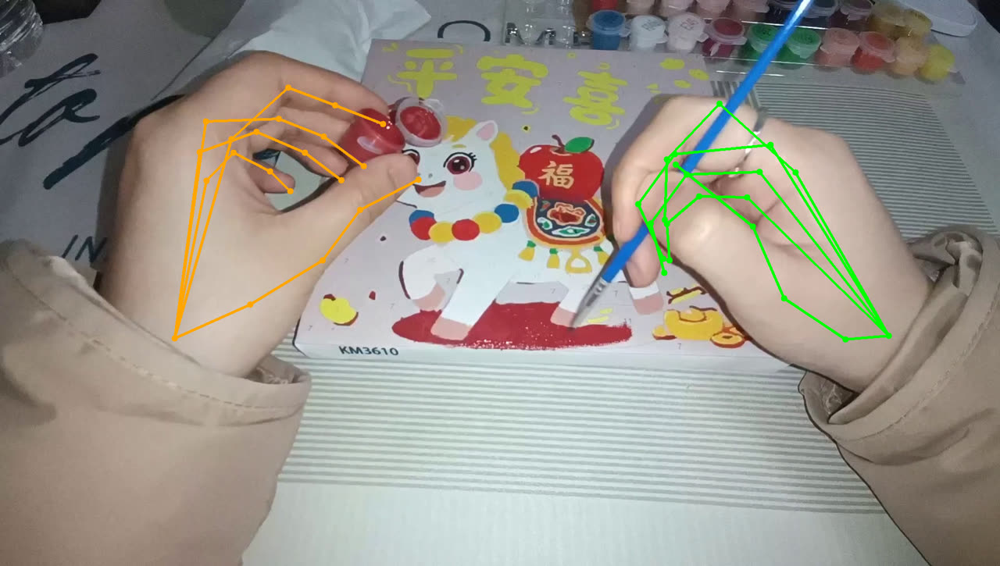
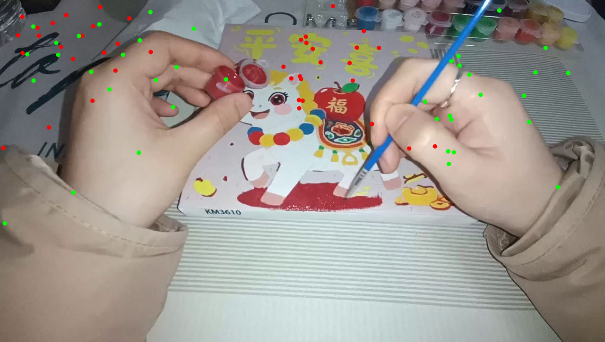

# QC Report: Intrinsics–Resolution Mismatch in POC Segments

> Community QC finding, submitted for discussion (issues appear to be disabled on this repo,
> hence a PR). All experiments are reproducible from released files only.
> 中文摘要见文末。

## Problem

In ~47% of the 111 POC segments, the intrinsics in `undistorted_video_info.json` are expressed
in a different resolution than the delivered `raw_video_undistorted.mp4`. Example
(`aoe_20260307_195104_p005`): the file states `resolution: "1920x1088"`, but
`fx=735.7, cx≈634.9, cy≈364.7` — a 1280×720 principal point. `camera_traj.npz['intrinsic']`
carries the same 720p-unit K.

Reconstruction appears to have consumed the delivered frames with the un-rescaled focal.
Since monocular hand depth follows `z = f·S/s_pix`, every translation in `hands.npz` **and**
`camera_traj.npz` is scaled by a per-segment factor `k = delivered_width / (2·cx)`:

| Device group | Segments | k | Translation bias |
|---|---|---|---|
| HUAWEI FRL-AN00a | 24 | ≈1.51 | shrunk ×0.66 |
| Xiaomi 23113RKC6C / vivo | 28 | ≈0.67 | inflated ×1.5 |
| Samsung / OPPO / others | 59 | ≈1.0 | unaffected |

Per-segment factors: [`intrinsics_scan_poc111.json`](intrinsics_scan_poc111.json).

## Key evidence (5-minute reproduction)

Project MANO-FK keypoints of a HUAWEI segment back onto the delivered video:

- `fx=fy=focal` (as-is) + principal at the **delivered frame centre** → aligns precisely:

  

- physically rescaled intrinsics (×1.5), or the json cx/cy as-is → does **not** align:

  

The surviving convention (720p focal + 1920-frame centre) matches HaWoR's code behaviour
(principal hard-coded to the input-frame centre, focal passed externally), implying the
reconstruction input was the delivered-resolution frames with the 720p focal value.

A static-hand regression (`argmin_α Σ‖α·R_c2w·p_cam + t_c2w − const‖` over hand-at-rest
windows) yields statistically identical α across the three device groups — the
`camera_traj.npz` translations carry the **same** per-segment factor as the hand branch,
which also explains why per-segment reprojection is self-consistent and invisible to
overlay QA and Procrustes-aligned metrics (PA-/WA-MPJPE).

## Impact

- Cross-segment, device-correlated ±50% multiplicative bias on all translation channels
  (wrist position/velocity in cam & world frame, camera translation). Per-dim normalization
  cannot remove a device-correlated trimodal bias.
- Unaffected: video frames, 45-D finger articulation, wrist rotation, betas, intra-hand
  geometry, open/close ratios.
- Consumers needing metric fidelity (retargeting/replay, co-training with robot data,
  velocity statistics) are affected. The full 2000 h release is presumably affected at a
  similar rate.

## Suggested fix (deterministic, no re-reconstruction)

1. Rescale all translations by `k = delivered_width / (2·cx)` per segment:
   `hands.npz` (`pred_trans*`, `t_c2w`, `t_w2c`) and `camera_traj.npz` (`cam_c2w[:3,3]`);
   rotations untouched.
2. Fix `undistorted_video_info.json` so `resolution` matches the intrinsics' pixel units
   (or rescale the intrinsics to the delivered resolution).
3. Add a pipeline assertion `|2·cx / delivered_width − 1| < 0.05` to prevent regressions.

We are happy to share the scan script and further verification details.

---

## 中文摘要

约 47% 的 POC segment 存在内参口径与交付视频分辨率不一致(如 resolution 写 1920×1088,
内参却是 1280×720 口径),重建疑似在交付视频上直接使用了未换算的 focal,导致 `hands.npz`
与 `camera_traj.npz` 的全部平移量被逐段缩放 k = 交付宽/(2·cx):华为 ×0.66、小米/vivo ×1.5、
三星/OPPO 正常。段内自洽(可视化与 Procrustes 对齐指标均无法发现),但跨段动作幅度不一致。
修复:逐段将两文件的平移乘 k(旋转不动),并修正元数据、增加 `2·cx≈交付宽` 断言。
五分钟复现:对华为段做双内参投影对比(见上两图)。
